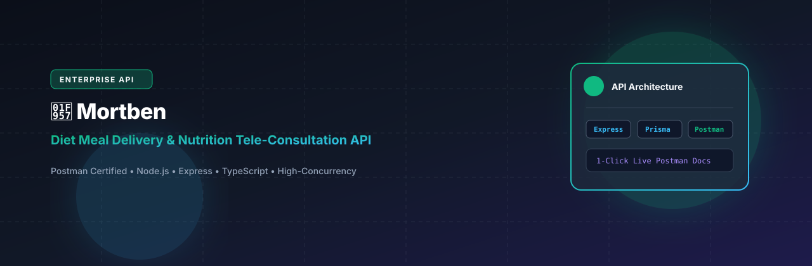
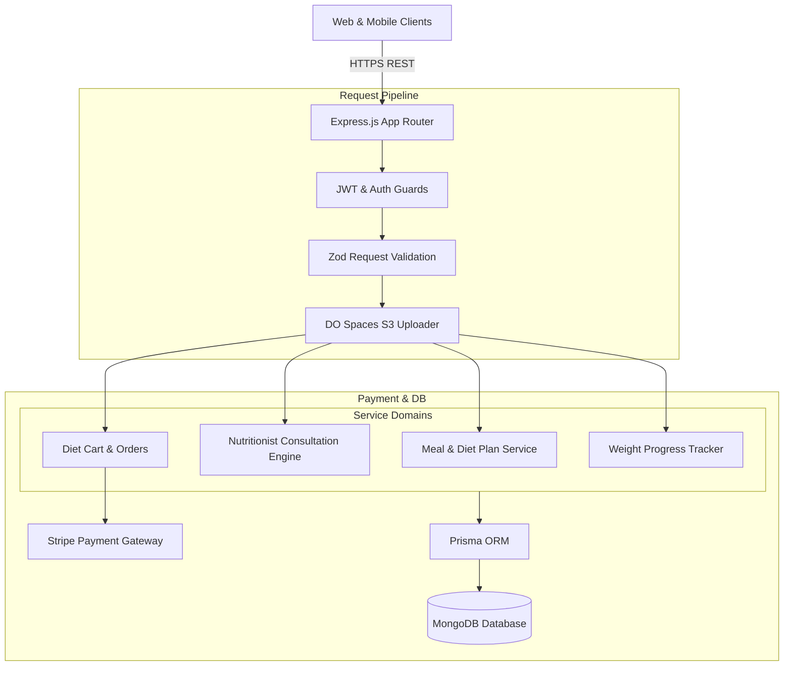

# Mortben Backend - Diet Meal Delivery & Nutrition Consultation API

<p align="center">
  
</p>

<p align="center">
  <a href="https://nodejs.org"></a>
  <a href="https://expressjs.com"></a>
  <a href="https://www.typescriptlang.org"></a>
  <a href="https://www.prisma.io"></a>
  <a href="https://www.mongodb.com"></a>
  <a href="https://stripe.com"></a>
  <a href="LICENSE"></a>
</p>

---

## 📖 Overview

**Mortben Backend (`mortben-backend`)** is an enterprise-scale healthy meal delivery and clinical nutrition consultation RESTful API. Built with Express.js, TypeScript, and Prisma ORM with MongoDB, the API orchestrates customized caloric meal subscription plans (daily, weekly, monthly), nutritionist appointment booking (online and clinic visits), body weight goal tracking, multi-city delivery availability, and integrated payments.

---

## ⚡ Key Features

- **🍱 Subscription Meal Planning & Delivery:** Tiered plans tailored for weight loss, muscle gain, maintenance, or therapeutic dietary protocols.
- **🩺 Nutritionist Consultations & Calendars:** Interactive appointment booking engine supporting both virtual telemedicine video slots and in-person consultations.
- **⚖️ Biometric Health & Weight Progress:** Longitudinal weight entry tracking correlated with nutritional intake and activity levels.
- **🛒 Diet Cart, Checkout & Logistics:** Flexible multi-meal order checkout supporting Stripe digital payments, bank transfers, and cash-on-delivery (COD).
- **🏙️ Geo-Fenced City Availability:** Dynamic urban zone coverage ensuring verified delivery radius fulfillment.

---

## 🏗️ System Architecture



---

## 🗂️ Project Structure

```
mortben-backend/
├── assets/
│   └── banner.svg               # Architectural repository banner
├── prisma/
│   └── schema.prisma            # MongoDB schema definitions
├── src/
│   ├── app/
│   │   ├── modules/             # Auth, User, Food, Meal, Package, Consultation, Order
│   │   ├── middlewares/         # Auth, validation, error handling
│   │   └── routes/              # Central route index
│   ├── config/                  # Environment bindings
│   ├── helpers/                 # FCM push, JWT, Twilio SMS
│   ├── shared/                  # DO Spaces uploader, Prisma client
│   ├── app.ts                   # Express application setup
│   └── server.ts                # HTTP server bootstrapper
├── package.json
└── tsconfig.json
```

---

## 🛠️ Tech Stack

| Technology | Purpose |
| :--- | :--- |
| **Node.js & Express 4** | Core backend HTTP web service |
| **TypeScript 5** | Strong typing and interface contracts |
| **Prisma ORM 6** | MongoDB document modeling and migrations |
| **MongoDB** | Database for meal catalogs, consultations, and users |
| **Stripe SDK** | Credit card payment processing and webhooks |
| **Twilio SDK** | SMS OTP verification and appointment reminders |
| **DigitalOcean Spaces** | Cloud storage for culinary imagery |

---

## 🚀 Getting Started

### Prerequisites

- Node.js >= 20.0.0
- MongoDB instance (MongoDB 6+)
- npm or yarn

### Installation

1. Clone the repository:
   ```bash
   git clone https://github.com/shahjalal-labs/mortben-backend.git
   cd mortben-backend
   ```

2. Install dependencies:
   ```bash
   npm install
   ```

3. Configure environment variables:
   ```bash
   cp .env.example .env
   ```

4. Generate Prisma Client:
   ```bash
   npx prisma generate
   ```

5. Run development server:
   ```bash
   npm run dev
   ```

---

## 📄 License

This project is licensed under the [ISC License](LICENSE).
